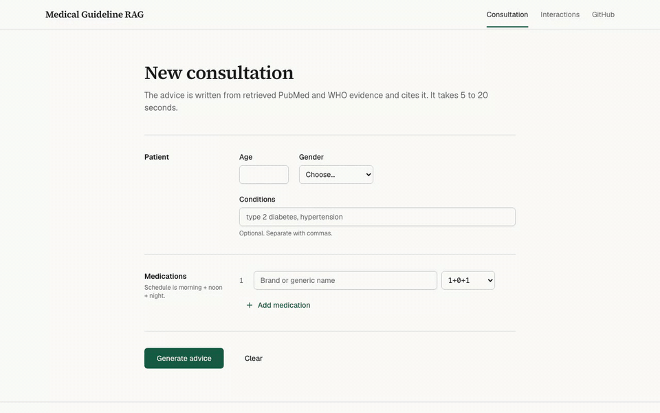

# Medical Guideline RAG System

[**Try the live demo**](https://iamaber-medical-guideline-rag.hf.space/consultation) · [Drug interaction checker](https://iamaber-medical-guideline-rag.hf.space/drug-interaction)



Medication guidance is spread across long drug monographs and thousands of research papers, so checking one patient's regimen by hand is slow. Enter a patient's medications, dose schedules, age, and conditions, and this app returns advice that cites the PubMed articles and MedEx drug monographs it used, with a link to each article.

It is for clinicians, pharmacy and medical students, and anyone who wants to see a RAG system that shows its sources.

- Searches 12,465 indexed records from 4,461 PubMed articles and 8 WHO guidelines with FAISS.
- Maps Bangladeshi brand names to generic drugs through 22,974 MedEx entries, so "Comet 500" is searched as metformin.
- Reads the MedEx monograph for each drug and gives its dosing and safety text to the model.
- Uses the patient's conditions in the search and in the prompt.
- Checks a small knowledge graph of known interactions (10 drugs, 5 pairs).
- Shows a labeled safety notice instead of advice when the model is unavailable.

## How answers stay grounded

The model receives the retrieved abstracts and monograph excerpts. The prompt tells it to base clinical claims on them, cite the supporting document next to each claim, and never invent a citation. Every answer lists its sources under **Evidence Sources**, with links to PubMed.

The example below comes from a live answer for a 58-year-old man with type 2 diabetes and hypertension who takes Comet 500 (metformin, `1+0+1`) and Amdocal 5 (amlodipine, `1+0+0`). One claim, next to the abstract it cites:

> **Answer:** "Poor adherence is a major challenge in hypertension management and is associated with suboptimal outcomes [39838337_abstract]."
>
> **Cited abstract** ([PMID 39838337](https://pubmed.ncbi.nlm.nih.gov/39838337/), *BMC Public Health*, 2025): "In Bangladesh, as in many other countries, poor adherence to medication represents a challenge to effective hypertension management."

When the evidence does not cover a question, the answer says so. The same answer ends with this note:

> "The provided evidence base does not contain specific data on the direct pharmacokinetic interaction between amlodipine and metformin beyond the general class effect of CCBs on glucose."

**For education only. This is not medical advice.**

## System Architecture


## Data Statistics

### Medical Literature Coverage
The figures below come from the bundled artifacts (`backend/data/documents_metadata.json`
and `backend/data/processed/`), not from upstream totals:

- Indexed records: 12,465 — 12,457 PubMed section records expanded from 4,461 unique
  articles, plus 8 WHO guideline records
- Source corpus: 34 domain files in `backend/data/processed/` (33 PubMed topic files and
  `who_guidelines.json`), holding 5,683 fetched article entries before de-duplication
- Largest topics: Tuberculosis (200 articles), Diabetes (199), Malaria (198)
- Drug brand lookup: 22,974 MedEx brand entries (`backend/data/drug_db/medex_URL.json`)
- Medical Domains Covered:
  - Diabetes, malaria, tuberculosis and other infectious diseases
  - Cardiovascular diseases, hypertension and chronic kidney disease
  - Maternal, neonatal and child health
  - WHO health guidelines and health-system topics
  - And 27 additional PubMed topic files

### Knowledge Graph Statistics
Reported by `MedicalKnowledgeGraph.get_stats()`:

- Total Nodes: 50 medical entities
- Drug Nodes: 10 pharmaceutical compounds
- Condition Nodes: 22 medical conditions
- Drug Class Nodes: 18 therapeutic classifications
- Known Interactions: 5 documented drug interactions
- Therapeutic Mappings: 10 indication relationships

### Vector Search Performance
- Embedding Model: all-MiniLM-L6-v2 (384 dimensions)
- Search Engine: FAISS with cosine similarity
- Multi-stage Retrieval: Enhanced with medical relevance scoring
- Patient Context: Age, gender, and condition-specific filtering
- Query Expansion: Automatic medical term enhancement

## Technology Stack

### Backend Framework
- Backend: FastAPI with async support
- Package Manager: UV for modern Python dependency management
- Python Version: 3.12+

### Frontend Framework
- Framework: Next.js 16 with App Router
- Language: TypeScript
- UI Components: shadcn/ui (Radix UI + Tailwind CSS)
- State Management: React Hooks
- API Client: Fetch API with TypeScript types

### AI & Machine Learning
- LLM: Groq/Qwen by default; Google Gemini, OpenAI, z.ai, Anthropic and DeepSeek also supported
- Embeddings: Sentence Transformers (all-MiniLM-L6-v2)
- Vector Database: FAISS for high-performance similarity search
- Knowledge Graph: NetworkX for drug interaction modeling

### Data Processing
- Medical Literature: PubMed article processing
- Guidelines: WHO health guideline integration
- Drug Data: Pharmaceutical database integration
- Format Support: JSON, PDF processing capabilities

### Development Tools
- Dependency Management: UV with pyproject.toml
- Code Quality: Black, isort, flake8
- Testing: Pytest with coverage
- Documentation: Comprehensive inline documentation

## Project Structure

```
medical-guideline-rag/
├── backend/                 # Python FastAPI backend
│   ├── app/               # FastAPI application
│   ├── config/            # Configuration management
│   ├── data/              # Medical datasets
│   ├── src/
│   │   ├── services/      # Business logic services
│   │   ├── models/        # Pydantic data models
│   │   ├── utils/         # Shared utility functions
│   │   ├── data_collection/ # Data fetching
│   │   └── preprocessing/   # Data cleaning
│   ├── templates/         # HTML report template
│   ├── uv.lock            # UV lock file
│   ├── pyproject.toml     # Python dependencies
│   └── .env.example       # Environment variable template (copy to .env)
├── frontend/                # Next.js React frontend
│   ├── src/
│   │   ├── app/           # Next.js App Router pages
│   │   ├── components/     # React components
│   │   │   └── ui/       # shadcn/ui components
│   │   └── lib/          # Utilities and API client
│   ├── package.json        # Node.js dependencies
│   ├── tsconfig.json       # TypeScript configuration
│   ├── tailwind.config.ts  # Tailwind CSS configuration
│   └── .env.local        # Frontend environment variables
├── assets/                # Documentation images
├── .gitignore
└── README.md
```

## Local Deployment

### Prerequisites

- Python 3.12 or higher
- Node.js 18+ and npm
- UV package manager
- Git

### Backend Setup

1. Navigate to backend directory:
```bash
cd backend
```

2. Create virtual environment and install dependencies:
```bash
uv sync
```

3. Activate virtual environment:
```bash
source .venv/bin/activate  # On Unix/macOS
# or
.venv\Scripts\activate     # On Windows
```

4. Configure environment variables (copy `backend/.env.example` to `backend/.env`):
```env
# AI Service Configuration — one provider, one key
LLM_PROVIDER=groq                    # groq | google | openai | anthropic | zai | ollama | azure | deepseek
LLM_MODEL=qwen/qwen3.8-27b
GROQ_API_KEY=your_api_key_here        # alternatively: LLM_API_KEY (takes precedence)
GROQ_REASONING_EFFORT=none            # instruct mode; empty omits the parameter

# Optional: external services
JINA_API_KEY=your_jina_api_key_here  # drug-monograph scraping; runs unauthenticated if unset
NCBI_EMAIL=your_email@example.com    # used by the offline PubMed fetch scripts only
NCBI_API_KEY=your_ncbi_api_key_here  # optional, raises the PubMed rate limit
```

`GROQ_API_KEY` (or the unified `LLM_API_KEY`) is the only secret the running API needs for
generated advice with the default provider. **No secret is committed to this repository**;
`backend/.env` is git-ignored. On Hugging Face, set `GROQ_API_KEY` as a Repository secret;
`NCBI_EMAIL`, `NCBI_API_KEY` and `JINA_API_KEY` are optional service settings.

Without an LLM key the API still starts: `/health` reports `status: degraded` and lists the
missing variable under `missing_configuration`, and `/advise` returns a fixed safety notice with
`advice_source: fallback` rather than generated guidance.

The remaining application settings (defaults shown):

```env
# Application Settings
ENVIRONMENT=development
LOG_LEVEL=INFO
LLM_MAX_TOKENS=1200
LLM_TEMPERATURE=0.3
LLM_TOP_P=0.8

# Vector Search Configuration
EMBEDDING_MODEL=sentence-transformers/all-MiniLM-L6-v2
VECTOR_SEARCH_TOP_K=10
FAISS_INDEX_PATH=data/vector_index.faiss
DOCUMENTS_METADATA_PATH=data/documents_metadata.json

# Data Directories
RAW_DIR=data/raw
PROCESSED_DIR=data/processed
API_PORT=8000
```

API protection is optional but recommended for any public deployment:

```env
# Browser origins allowed by CORS (comma-separated)
CORS_ALLOW_ORIGINS=http://localhost:3000

# When set, /advise, /advise/html and /drug_interactions require X-API-Key
API_KEY=

# Per-client requests per minute, and the hard cap on one advice request
RATE_LIMIT_PER_MINUTE=20
ADVISE_TIMEOUT_SECONDS=120
```

5. Initialize the system:
```bash
# Optional: rebuild the FAISS index from backend/data/processed/.
# The API also does this lazily at startup when data/vector_index.faiss is absent.
uv run python -c "from src.services.vector_search import VectorSearch; VectorSearch().load_processed_data()"

# Start the development server
uv run uvicorn app.main:app --reload --port 8000
```

### Frontend Setup

1. Navigate to frontend directory:
```bash
cd frontend
```

2. Install dependencies:
```bash
npm install
```

3. Configure environment variables (create `.env.local` in `frontend/`):
```env
NEXT_PUBLIC_API_URL=http://localhost:8000
```

4. Start the development server:
```bash
npm run dev
```

5. Access the application:
- Frontend: http://localhost:3000
- Backend API: http://localhost:8000
- API Documentation: http://localhost:8000/docs
- Health Check: http://localhost:8000/health

### Hugging Face Space

The root `Dockerfile` packages the whole app for a Docker Space on free
`cpu-basic` hardware (2 vCPU, 16 GB RAM). It builds a Next.js static export with
Node 22 and installs the backend with Python 3.12 and `uv sync --frozen --no-dev`.
FastAPI serves the UI at `/`, `/consultation/` and `/drug-interaction/`, alongside
the API, on port 7860 as non-root UID 1000. API information is at `/api`; a
backend-only server without an export also retains the JSON response at `/`.
The existing `backend/Dockerfile` continues to serve only the backend on 8000.

Groq with Qwen 3.8 27B is the default, so `LLM_PROVIDER` and `LLM_MODEL` are only
needed as Space variables to change it. Set `GROQ_API_KEY` (required) and, as needed,
`JINA_API_KEY`, `NCBI_EMAIL` and `NCBI_API_KEY` as runtime Space secrets, never as
variables, which are public. No secrets are needed during the build. The Docker context
excludes local environment files and includes `backend/data`. Leave
`NEXT_PUBLIC_API_URL` empty for same-origin browser requests; when running the
frontend separately in development, use `http://localhost:8000` as shown above.
Public frontend variables are baked into the export at build time.

The container sets `TRUSTED_PROXIES` to loopback and private IPv4/IPv6 networks
used by the Space's internal proxy hops. Uvicorn runs with `--no-proxy-headers`
so the application's existing right-to-left `X-Forwarded-For` validation sees
the socket peer and applies limits per public client. Trusting all addresses
would also trust the clients and collapse their quotas onto the proxy. Adjust
the CIDRs if the hosting proxy uses different networks; direct deployments
should trust only their own proxies.

To build and run locally from the repository root:

```bash
docker build -t medical-guideline-rag .
docker run --rm -p 7860:7860 --env-file backend/.env medical-guideline-rag
```

To check the same static UI setup without Docker:

```bash
cd frontend
NEXT_PUBLIC_API_URL= npm ci
NEXT_PUBLIC_API_URL= npm run build
cd ../backend
FRONTEND_DIST=../frontend/out uv run uvicorn app.main:app --host 127.0.0.1 --port 7860 --no-proxy-headers
```

The health check uses `/health` on 7860 and accepts degraded service status
when optional runtime credentials are missing. See the
[Docker Spaces documentation](https://huggingface.co/docs/hub/spaces-sdks-docker)
for Space settings and runtime secrets.

## API Endpoints

### Medical Consultation
- POST /advise - Complete medical consultation with AI advice
- POST /advise/html - Medication advice with HTML formatting
- GET /search_drugs - Search for drug names in database
- GET /drug_info/{drug_name} - Drug information lookup
- POST /drug_interactions - Drug interaction analysis

### System Monitoring
- GET /health - System health check
- GET /stats - System statistics and performance metrics

### Example API Usage

```python
import requests

# Medical consultation (see UserInput in backend/src/models/schemas.py)
consultation_data = {
    "meds": ["metformin", "lisinopril"],
    "schedule": ["1+0+1", "1+0+0"],
    "age": 45,
    "gender": "F",
    "conditions": ["diabetes", "hypertension"],
}

response = requests.post("http://localhost:8000/advise", json=consultation_data)
medical_advice = response.json()
```

## Development and Testing

### Backend Testing
```bash
cd backend

# Run all tests
uv run pytest

# Run with coverage
uv run pytest --cov=src --cov-report=html

# Run specific test file
uv run pytest tests/test_vector_search.py -v
```

### Code Quality (Backend)
```bash
cd backend

# Format code
uv run black src/ app/ config/ tests/

# Sort imports
uv run isort src/ app/ config/ tests/

# Lint code
uv run flake8 src/ app/ config/ tests/
```

### Frontend Testing
```bash
cd frontend

# Run linting
npm run lint

# Run type checking
npm run type-check
```

## Medical AI Features

### Evidence-Based Reasoning
- Literature Integration: Local FAISS index over 12,465 records (4,461 PubMed articles, 8 WHO guidelines)
- Guideline Compliance: WHO and medical society guideline integration
- Safety Prioritization: Contraindication and interaction checking
- Contextual Advice: Patient-specific recommendations

### Advanced Search Capabilities
- Semantic Search: Understanding medical terminology and context
- Multi-modal Retrieval: Text, symptoms, and medication-based search
- Relevance Scoring: Medical domain-specific ranking algorithms
- Query Expansion: Automatic medical term enhancement

### Drug Interaction Analysis
- Comprehensive Database: Known drug interactions and contraindications
- Risk Assessment: Severity classification and clinical significance
- Monitoring Parameters: Required clinical monitoring recommendations
- Safety Alerts: Real-time interaction warnings

## LLM Provider Configuration

The default provider is Groq with Qwen 3.8 27B. Set both `LLM_PROVIDER` and `LLM_MODEL`
when switching providers. `LLM_API_KEY` works with every provider and takes precedence over
the provider-specific key. Gemini remains available as an option.

### Groq / Qwen (default)
```env
LLM_PROVIDER=groq
GROQ_API_KEY=your_api_key
LLM_MODEL=qwen/qwen3.8-27b
GROQ_REASONING_EFFORT=none
LLM_MAX_TOKENS=1200
LLM_TEMPERATURE=0.3
LLM_TOP_P=0.8
```

Qwen runs in instruct mode through `reasoning_effort="none"`, as described in the
[Groq model documentation](https://console.groq.com/docs/model/qwen/qwen3.8-27b).
Set `GROQ_REASONING_EFFORT=` to omit the parameter for other Groq models, or set it to
an effort value supported by your selected model. With locked Pydantic AI 1.30.1 the
client sends this field through `ModelSettings.extra_body`.

Each Groq generation makes one attempt (`max_retries=0`, agent retries disabled, one model
request allowed) with a 30-second SDK timeout and a 30-second overall generation deadline.
Missing keys, rate limits/quota, timeouts and other failures return the existing safety
fallback with a short service note; safe `Retry-After` hints are included when available.
Provider error bodies, keys and tracebacks are not returned or logged by the client.

The complete system and user prompts are capped at **16,000 characters** (roughly 4,000
tokens at four characters per token; this is an estimate, not a tokenizer guarantee).
Oversized prompts return the fallback without silently removing patient details. Existing
evidence caps remain: top five articles, 700 characters of text per article, 6,000 characters
for the evidence section, and 4,000 for drug monographs. Output defaults to **1,200 tokens**
and `LLM_MAX_TOKENS` is capped at **2,048**, giving about 5,200 tokens total by default and
about 6,048 at the output cap, plus message-format overhead. These prompt/output caps apply
to all generation paths, including synchronous summarization.

### Google (Gemini)
```env
LLM_PROVIDER=google
GOOGLE_API_KEY=your_api_key
LLM_MODEL=gemini-2.0-flash
```

### OpenAI
```env
LLM_PROVIDER=openai
OPENAI_API_KEY=your_api_key
LLM_MODEL=gpt-4o
```

### z.ai
```env
LLM_PROVIDER=zai
ZAI_API_KEY=your_api_key
LLM_MODEL=zai-model
```

### Anthropic (Claude)
```env
LLM_PROVIDER=anthropic
ANTHROPIC_API_KEY=your_api_key
LLM_MODEL=claude-3-5-sonnet
```

### DeepSeek
```env
LLM_PROVIDER=deepseek
DEEPSEEK_API_KEY=your_api_key
LLM_MODEL=deepseek-chat
```

## Safety and Compliance

### Medical Safety Features
- Contraindication Checking: Automatic safety screening
- Drug Interaction Analysis: Comprehensive interaction database
- Age-Appropriate Recommendations: Pediatric and geriatric considerations

### Disclaimer

Important Medical Disclaimer: This system is designed to assist healthcare professionals and provide educational information. It is not a substitute for professional medical advice, diagnosis, or treatment. Always consult qualified healthcare providers for medical decisions.

## Contributing

How to make contributions to improve the Medical Guideline RAG System:

1. Fork the repository
2. Create a feature branch: `git checkout -b feature/medical-enhancement`
3. Install development dependencies:
   - Backend: `cd backend && uv sync` (the default `dev` dependency group is included)
   - Frontend: `cd frontend && npm install`
4. Make your changes with comprehensive tests
5. Run quality checks:
   - Backend: `uv run pytest && uv run black --check . && uv run flake8`
   - Frontend: `npm run lint && npm run type-check && npm run build`
6. Submit a pull request with detailed medical context

### Development Guidelines
- Follow medical coding standards and terminology
- Include comprehensive test coverage for medical logic
- Document all medical algorithms and decision trees
- Ensure patient safety considerations in all features

## License

The application code is released under the **MIT License**; see [LICENSE](LICENSE).

The eight WHO PDFs and WHO-derived summaries, metadata and vector-index
material are provided under **CC BY-NC-SA 3.0 IGO**, for **non-commercial use
only**. Adaptations must use the same or an equivalent licence. WHO does not
endorse this project. Embedded third-party material retains its own terms.
See [LICENSE-DATA.md](LICENSE-DATA.md) for the document attributions, exact
PDF licence notices, suggested citations and disclaimers.

The corpus also includes PubMed abstracts and a MedEx Bangladesh drug-brand
lookup database. Their redistribution licences are not documented in the
repository; neither the MIT code licence nor the WHO licence grants rights
to those separate sources. See the other-data section in LICENSE-DATA.md.

## Acknowledgments

- Medical Literature: PubMed and medical research community
- WHO Guidelines: World Health Organization health policies
- AI Technology: Google Gemini AI, OpenAI, and Sentence Transformers
- Open Source: FAISS, NetworkX, FastAPI, Next.js, and shadcn/ui communities

## Support & Feedback

If you find this project helpful, please consider starring the repository on GitHub. Feel free to open issues or discussions for feedback, feature requests, or questions.
